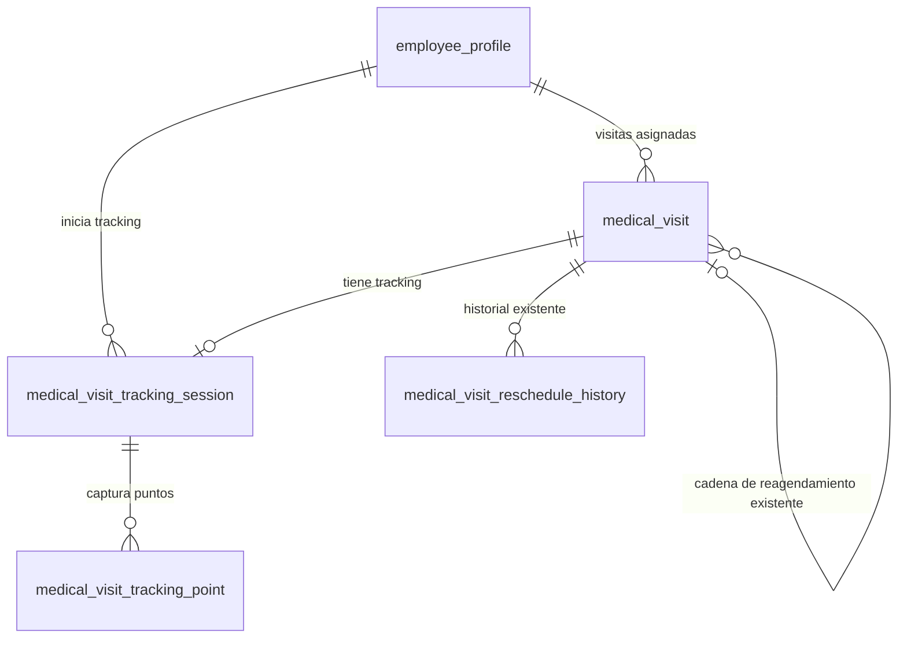

# Esquema de tracking para Mercurius

Fecha: 10 de septiembre de 2026.

## Decisión de arquitectura

Mercurius utilizará la misma base de datos y el mismo backend de Interactive
Core. Se crearán tablas nuevas únicamente para almacenar el tracking móvil.

Mercurius no duplicará en las tablas de tracking:

- visitadores;
- usuarios;
- médicos;
- clínicas;
- especialidades;
- visitas médicas;
- eventos o efectividades;
- información de reagendamiento.

Esos datos continuarán almacenándose y gestionándose mediante las tablas y APIs
existentes de Interactive Core.

## Tablas nuevas

### 1. `medical_visit_tracking_session`

Representa la sesión de tracking de una visita médica.

| Columna | Tipo | Nulo | Uso |
|---|---|---:|---|
| `id` | `bigint` | No | Clave primaria |
| `session_uuid` | `uuid` | No | Identificador único generado por Mercurius |
| `visit_id` | `bigint` | No | FK única a `medical_visit.id` |
| `visitor_id` | `bigint` | No | FK a `employee_profile.id` |
| `status` | `varchar(20)` | No | Estado del tracking |
| `started_at_device` | `timestamptz` | No | Hora de inicio reportada por el teléfono |
| `started_at_server` | `timestamptz` | No | Hora de recepción en el backend |
| `finished_at_device` | `timestamptz` | Sí | Hora final reportada por el teléfono |
| `finished_at_server` | `timestamptz` | Sí | Hora final registrada por el backend |
| `device_identifier` | `varchar(150)` | Sí | Identificador no sensible del dispositivo |
| `app_version` | `varchar(30)` | Sí | Versión instalada de Mercurius |
| `created_at` | `timestamptz` | No | Fecha de creación |
| `updated_at` | `timestamptz` | No | Última actualización |

Valores de `status`:

```text
IN_PROGRESS
COMPLETED
RESCHEDULED
CANCELLED
```

`RESCHEDULED` solo indica por qué terminó el tracking. No ejecuta ni reemplaza
la lógica de reagendamiento de Interactive Core.

Relaciones:

- `visit_id → medical_visit.id`, con eliminación `CASCADE`.
- `visitor_id → employee_profile.id`, recomendado `PROTECT` para conservar la
  auditoría.
- `visit_id` debe ser único: una versión concreta de una visita tiene una sola
  sesión de tracking.

El backend debe obtener `visitor_id` desde el usuario autenticado. Mercurius no
debe poder enviar arbitrariamente el ID de otro visitador.

### 2. `medical_visit_tracking_point`

Almacena las coordenadas capturadas durante una sesión.

| Columna | Tipo | Nulo | Uso |
|---|---|---:|---|
| `id` | `bigint` | No | Clave primaria |
| `point_uuid` | `uuid` | No | ID único generado por Mercurius |
| `session_id` | `bigint` | No | FK a `medical_visit_tracking_session.id` |
| `point_type` | `varchar(15)` | No | Tipo de marcación |
| `latitude` | `numeric(9,6)` | No | Latitud entre -90 y 90 |
| `longitude` | `numeric(9,6)` | No | Longitud entre -180 y 180 |
| `accuracy_meters` | `numeric(8,2)` | Sí | Precisión informada por el GPS |
| `altitude_meters` | `numeric(9,2)` | Sí | Altitud |
| `speed_mps` | `numeric(8,2)` | Sí | Velocidad en metros por segundo |
| `heading_degrees` | `numeric(6,2)` | Sí | Dirección entre 0 y 360 grados |
| `location_source` | `varchar(10)` | No | Fuente de la posición |
| `is_mocked` | `boolean` | No | Indica una ubicación simulada |
| `captured_at_device` | `timestamptz` | No | Hora de captura del teléfono |
| `received_at_server` | `timestamptz` | No | Hora de recepción del servidor |
| `created_at` | `timestamptz` | No | Fecha de creación |

Valores de `point_type`:

```text
CHECK_IN
POSITION
CHECK_OUT
```

Valores de `location_source`:

```text
GPS
NETWORK
CACHED
```

Relaciones y restricciones:

- `session_id → medical_visit_tracking_session.id`, con eliminación `CASCADE`.
- `point_uuid` debe ser único para evitar duplicados al reintentar envíos.
- Una sesión debe tener como máximo un `CHECK_IN` y un `CHECK_OUT`.
- Puede tener múltiples puntos `POSITION` si más adelante se habilita tracking
  continuo.

## Relaciones completas



## Flujo para mostrar información en Mercurius

Mercurius obtiene los datos desde Interactive Core usando el token del usuario:

```http
GET /api/v1/medical-visits?start={fecha}&end={fecha}
GET /api/v1/medical-visit/{id}
GET /api/v1/doctors?schedule=true
GET /api/v1/server-time
```

La aplicación muestra el nombre del visitador desde el JWT y las visitas desde
las APIs. Los nombres y datos administrativos no se copian a las tablas de
tracking; el backend puede obtenerlos mediante las relaciones existentes.

## Flujo de inicio de visita

1. El usuario pulsa **Iniciar visita**.
2. Mercurius registra la hora del teléfono y obtiene la ubicación.
3. El backend valida que la visita pertenece al usuario autenticado.
4. Se crea una fila en `medical_visit_tracking_session` con
   `status = IN_PROGRESS`.
5. Se crea un punto `CHECK_IN` en `medical_visit_tracking_point`.

Contrato sugerido para el nuevo endpoint:

```http
POST /api/v1/medical-visits/{visit_id}/tracking/start
Authorization: Bearer <access_token>
Content-Type: application/json
```

```json
{
  "session_uuid": "27af330c-e928-49ef-a799-e66b16ad50cc",
  "captured_at_device": "2026-09-10T09:05:00-06:00",
  "location": {
    "point_uuid": "45b27118-4aa9-4afd-b1e0-b880269c527b",
    "latitude": 14.072300,
    "longitude": -87.192100,
    "accuracy_meters": 8.0,
    "location_source": "GPS",
    "is_mocked": false
  },
  "device_identifier": "installation-uuid",
  "app_version": "1.0.0"
}
```

## Flujo de finalización

El cierre mantiene la lógica normal de Interactive Core.

1. Mercurius obtiene hora y ubicación final.
2. Envía los datos clínicos al endpoint existente:

```http
PATCH /api/v1/medical-visit/update/{visit_id}
```

3. Interactive Core actualiza normalmente `medical_visit` con:
   - `start_date_real`;
   - `end_date_real`;
   - evento;
   - efectividad;
   - notas;
   - estado `Completada`;
   - evaluación del médico, si aplica.
4. Se cierra la sesión de tracking y se agrega el punto `CHECK_OUT`.

Contrato sugerido para el nuevo endpoint de tracking:

```http
POST /api/v1/medical-visits/{visit_id}/tracking/finish
Authorization: Bearer <access_token>
Content-Type: application/json
```

```json
{
  "session_uuid": "27af330c-e928-49ef-a799-e66b16ad50cc",
  "status": "COMPLETED",
  "captured_at_device": "2026-09-10T09:35:00-06:00",
  "location": {
    "point_uuid": "755b785a-1e71-4dcb-b4de-2990c8547ce0",
    "latitude": 14.072350,
    "longitude": -87.192080,
    "accuracy_meters": 6.0,
    "location_source": "GPS",
    "is_mocked": false
  }
}
```

La actualización de la visita y el cierre del tracking deberían coordinarse en
una transacción del backend para impedir que una operación quede aplicada y la
otra no.

## Flujo de reagendamiento desde Mercurius

Mercurius únicamente aporta la nueva pantalla. La lógica y las tablas usadas
son las actuales de Interactive Core.

```http
POST /api/v1/medical-visits/reschedule/{visit_id}
Authorization: Bearer <access_token>
Content-Type: application/json
```

```json
{
  "rescheduled_reason": "El médico solicitó cambio de horario",
  "start_date_plan": "2026-09-12T10:00:00-06:00",
  "end_date_plan": "2026-09-12T10:30:00-06:00"
}
```

El backend actual se encarga de:

- validar que la visita pertenece al usuario;
- rechazar fechas pasadas y cruces de horario;
- validar el máximo de tres reagendamientos;
- marcar la visita original como `Reagendada`;
- insertar el historial en `medical_visit_reschedule_history`;
- crear la nueva fila `Pendiente` en `medical_visit`;
- enlazar la cadena mediante `parent_visit_id` y `root_visit_id`.

Las tablas de tracking no almacenan el motivo, las fechas nuevas ni copias de
la nueva visita. Si la visita ya tenía tracking activo, esa sesión únicamente
se cierra con `status = RESCHEDULED` después de que el endpoint actual responda
exitosamente.

## Tablas existentes que permanecen sin cambios

```text
medical_visit
medical_visit_reschedule_history
employee_profile
api_user
api_doctor
medical_clinic
api_specialty
event_medical_visit
effectiveness_medical_visit
doctor_qualitative_evaluation
```

## Resumen

Solamente se agregan:

```text
medical_visit_tracking_session
medical_visit_tracking_point
```

Todas las demás operaciones se ejecutan con las APIs y tablas normales de
Interactive Core. Este documento es un diseño; no se realizaron modificaciones
en el backend.
